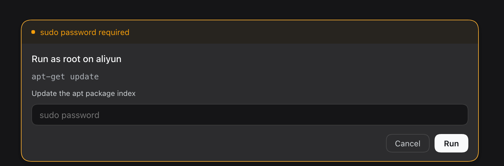

# dsh-sudo-askpass


DSH 的远端 sudo 密码面板：在输入框位置弹出，密码只走 stdin，不进对话、工具参数、环境变量或磁盘。

A composer-hosted sudo password prompt for DeepSeek Harness: the password goes to the remote `sudo` over stdin and never enters the transcript, tool arguments, environment, or disk.

[中文](#中文) · [English](#english)



---

## 中文

### 功能

- **composer 面板**：接管输入框，显示主机、命令、密码；Enter 提交，Esc 取消。
- **单一缓存开关**：`passwordTtlMs: 0` 每次都要密码；正整数时密码只在宿主内存保留该时长。
- **不依赖 sudo ticket**：每次执行后 `sudo -k`，不假设 ticket 能跨 ssh 复用。
- **自动探测 sudo**：先试常见绝对路径，再用 `command -v sudo` 兜底。
- **中英文**：跟随 DSH 语言；root 命令的 stdin 固定 `/dev/null`。

### 安装

插件管理器：侧栏 → 插件 → 添加插件 → 安装第三方插件 → 本地目录。

手动：

```bash
dsh plugin --profile desktop add /absolute/path/to/dsh-sudo-askpass
```

然后在 profile 的 `cordis.patch.yml` 加入：

```yaml
- insert:
    - id: sudo-askpass
      name: 'dsh-sudo-askpass'
```

重启 DSH。前置条件：`ssh <host>` 能密钥登录。

### 配置

```yaml
config:
  passwordTtlMs: 0   # 0 = 每次都要密码；正整数 = 内存缓存毫秒数
```

| 键 | 默认 | 说明 |
|---|---|---|
| `passwordTtlMs` | `0` | `0` = 每次都要密码；正整数 = 密码在宿主内存保留的毫秒数 |

### 使用

让 agent 调用 `remote_sudo`：

> 用 `remote_sudo` 在 aliyun 上执行 `apt-get update`

| 参数 | 必填 | 说明 |
|---|---|---|
| `host` | 是 | `~/.ssh/config` 别名 |
| `command` | 是 | 远端 root 命令 |
| `description` | 否 | 面板里的短标签 |

需要密码时弹面板；`passwordTtlMs` 内不重复弹；取消/停止会结束调用。

### 安全边界

- **能挡**：argv、环境变量、shell history、工具参数、对话记录、远端磁盘、SSH 明文传输。
- **挡不住**：浏览器插件域（任何 client 插件都能读输入）、宿主内存、本机回环 HTTP、被入侵的远端、JS 内存残留、单因子。
- **建议**：专用 sudo 密码；Web UI 只绑 loopback 或上 HTTPS；需要更强隔离时用原生 askpass、Touch ID 或 scoped `NOPASSWD`。

### 限制

- 只支持 SSH 远端，不支持本机 root。
- 没有内置超时：密码等待和命令执行都会一直阻塞，直到回答/取消/ssh 结束。
- 取消/停止只杀本地 ssh，远端进程不保证停止；需要硬上限时在远端命令里用 `timeout`。
- 同时只展示一个 prompt；远端需 POSIX shell + sudo。

### 开发

```bash
npm test
node test/real-host-probe.mjs   # 手动：真实主机 + 错误密码验证链路
```

---

## English

### Features

- **Composer panel**: takes over the input box with host, command, and password; Enter submits, Esc cancels.
- **One cache knob**: `passwordTtlMs: 0` asks every call; a positive value keeps the password in host memory for that window.
- **No sudo ticket reuse**: runs `sudo -k` after every command and never assumes a no-TTY ticket survives across ssh.
- **Auto-detect sudo**: common absolute paths first, then `command -v sudo`.
- **Bilingual**: follows the DSH locale; the root command's stdin is always `/dev/null`.

### Install

Plugin manager: sidebar → Plugins → Add plugin → Install third-party plugin → Local directory.

Manual:

```bash
dsh plugin --profile desktop add /absolute/path/to/dsh-sudo-askpass
```

Then add this row to the profile's `cordis.patch.yml`:

```yaml
- insert:
    - id: sudo-askpass
      name: 'dsh-sudo-askpass'
```

Restart DSH. Requires key-based `ssh <host>` access.

### Configuration

```yaml
config:
  passwordTtlMs: 0   # 0 = ask every call; positive = in-memory TTL in ms
```

| Key | Default | Meaning |
|---|---|---|
| `passwordTtlMs` | `0` | `0` asks every call; a positive value is the in-memory password TTL in milliseconds |

### Usage

Ask the agent to call `remote_sudo`:

> Use `remote_sudo` to run `apt-get update` on aliyun

| Argument | Required | Meaning |
|---|---|---|
| `host` | yes | SSH alias from `~/.ssh/config` |
| `command` | yes | root command to run remotely |
| `description` | no | short label shown in the panel |

The panel appears when a password is needed; within `passwordTtlMs` it does not ask again. Cancel/stop ends the call.

### Security

- **Protected**: argv, environment, shell history, tool arguments, transcript, remote disk, plaintext transport.
- **Not protected**: the browser plugin realm (any client plugin can read the input), host memory, loopback HTTP, a compromised remote, JS memory residue, a single factor.
- **Recommendations**: a dedicated sudo password; bind the Web UI to loopback or use HTTPS; for stronger isolation use a native askpass, Touch ID, or scoped `NOPASSWD`.

### Limitations

- Remote SSH only; no local root.
- No built-in timeout: both the password wait and the command run block until answered, cancelled, or ssh exits.
- Cancel/stop kills the local ssh; the remote process is not guaranteed to stop. Use `timeout` in the remote command for a hard limit.
- One prompt at a time; the remote must be POSIX with sudo.

### Development

```bash
npm test
node test/real-host-probe.mjs   # manual: real host + wrong password
```

## License

MIT
